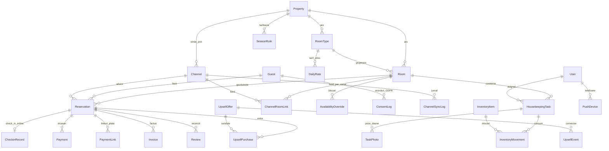

# Schema de date — Adonis Host

Sursa: [`packages/database/prisma/schema.prisma`](packages/database/prisma/schema.prisma) · migrarea de producție: `packages/database/prisma/migrations/`.

## Principii

- **Aceeași schemă pe SQLite (dev) și PostgreSQL (producție).** Câmpurile cu valori fixe (stări, canale, tonuri) sunt `String`, validate în cod (`packages/database/src/enums.ts`, scheme zod în API). Listele și obiectele (facilități, etichete, reguli de sezon) sunt JSON salvat ca text. Trecerea la PostgreSQL schimbă doar linia `provider` (`scripts/prisma-provider.mjs`).
- **Sumele în lei, cu TVA inclus** în `totalAmount` (așa se vând camerele). Taxa turistică stă separat (`touristTax`), pentru că nu intră în baza de TVA.
- **Datele de sejur sunt zile, nu momente.** `checkIn`/`checkOut` se salvează la miezul nopții UTC; o rezervare ocupă nopțile `[checkIn, checkOut)`.

## Diagrama relațiilor principale

## Decizii de modelare

| Zonă | Modele | De ce așa |
|---|---|---|
| Proprietate | `Property`, `RoomType`, `Room` | Un singur hotel azi, dar `propertyId` peste tot permite un al doilea fără migrare. Facilitățile reale Adonis: `seaView` (full / side / none), `hasBalcony`, `amenities` (Daikin, frigider, TV LED, seif, Wi-Fi, șezlong). |
| Rezervări | `Reservation`, `Guest`, `Payment` | `code` lizibil (`ADN-2027-0042`), `checkinToken` unic pentru linkul oaspetelui. `paidAmount` e denormalizat (suma plăților) pentru liste rapide. |
| Oaspeți | `Guest`, `ConsentLog` | Etichete libere (`oaspete_fidel`, `familie_cu_copii`), alergii, preferințe. Fiecare acord GDPR (prelucrare, scanare act, marketing, WhatsApp) e un rând separat cu sursă, IP și dată, ca să poată fi dovedit. |
| Check-in | `CheckinRecord` | Un rând per rezervare: tip și număr act, căile către poza actului și semnătură (în stocare, nu în bază), versiunea contractului semnat. |
| Canale | `Channel`, `ChannelRoomLink`, `ChannelSyncLog` | Vezi secțiunea următoare. |
| Tarife | `SeasonRule`, `DailyRate`, `AvailabilityOverride` | Vezi „Sezonalitate”. |
| Mesaje | `MessageTemplate`, `WhatsappConversation` | `tone` = `warm_formal` / `casual_friendly` / `festive`; `trigger` = momentul din sejur. |
| Operațional | `HousekeepingTask`, `TaskPhoto`, `InventoryItem`, `InventoryMovement`, `AccessCode` | Sarcina are cronometru (`startedAt` → `minutesSpent`). Consumabilele scad automat cu `perCheckout` la fiecare curățenie de plecare. `AccessCode` are câmpuri pentru TTLock/Salto (`provider`, `lockId`). |
| Venituri extra | `UpsellOffer`, `UpsellPurchase`, `UpsellEvent`, `PaymentLink` | Categoriile cerute (`room_upgrade`, `restaurant`, `wellness`, `experience`, `event`) și `seasonalRules` JSON. `UpsellEvent` înregistrează afișare → clic → cumpărare pentru rata de conversie. |
| Fiscal | `Invoice`, `TouristTaxRule`, `FinancialReport` | Factura păstrează liniile ca JSON (exact ce s-a emis), plus starea e-Factura și id-ul SmartBill. Taxa turistică are reguli pe localitate cu dată de intrare în vigoare. |
| Analitic | `Review`, `Alert` | Notele normalizate pe 0–10 indiferent de sursă. Alertele se generează fără dubluri cât timp una similară e deschisă. |
| Personal | `User`, `PushDevice` | Roluri: proprietar, manager, recepție, curățenie, întreținere. Parole scrypt. |
| Media | `MediaAsset` | `entityType` + `entityId` leagă orice fotografie de proprietate, tip de cameră sau ofertă; `sourcePath` ține legătura cu fișierul original din arhivă. |

## iCal azi, XML mâine, fără refactorizare

- `Channel.syncType` = `ical` | `xml` | `none`.
- `ChannelRoomLink` are **ambele** referințe: `importUrl` (feed iCal) și `externalRoomId` (id-ul camerei la Booking pentru XML).
- `Reservation` are `externalUid` (UID-ul din iCal) **și** `externalBookingId` (id-ul rezervării Booking din XML). Unicitatea `(channelId, externalUid)` face sincronizarea idempotentă.
- `ChannelSyncLog.type` = `ical` | `xml` | `unified`.
- În cod, ambele surse implementează aceeași interfață `ChannelSync.fetchEvents()` (`packages/core/src/sync`). Trecerea unui canal pe XML înseamnă: `syncType = "xml"`, completarea `externalRoomId`, activarea transportului. Vezi [docs/booking-xml-migration.md](docs/booking-xml-migration.md).

## Sezonalitate și tarife

Prețul unei nopți se alege în ordinea:
1. `DailyRate` explicit pentru tipul de cameră și dată (ex: o seară cu concert);
2. regula `SeasonRule` cu prioritatea cea mai mare care acoperă data — o regulă pe un anumit tip de cameră câștigă la prioritate egală;
3. `RoomType.baseRate` (extrasezon).

Fiecare regulă are `multiplier` și `minStay`. Exemplu din datele demo: Vârf de sezon (10 iulie – 20 august) ×1.7, minim 3 nopți; 1 Mai ×1.5; Rusaliile se recalculează în fiecare an (Paștele ortodox + 49 de zile); Revelion ×1.6. `AvailabilityOverride` blochează o cameră (reparație, uz propriu) și apare în calendarele exportate.

## Fotografii

Arhiva originală (132 de fotografii) nu intră în git. Variantele WebP optimizate sunt în `apps/*/public/photos`, iar `MediaAsset` le descrie (categorie, text alternativ). În producție fișierele încărcate de oaspeți și personal merg în Cloudflare R2; baza păstrează doar cheia.
