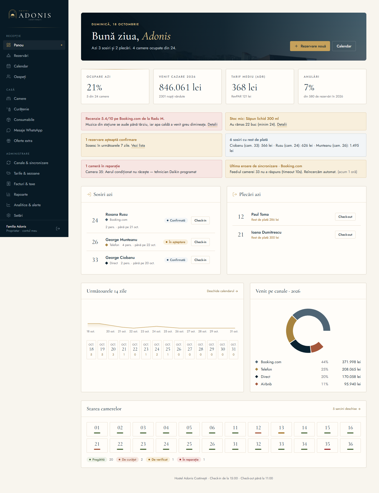

# Adonis Host

Sistemul de administrare al **Hostelului Adonis Costinești** — 24 de camere, 54 de locuri, la 35 m de Marea Neagră.



## Ce conține

| Aplicație | Pentru cine | Ce face |
|---|---|---|
| `apps/admin` (Next.js 14) | Recepție, proprietar | Rezervări, calendar, oaspeți, camere, curățenie, consumabile, mesaje WhatsApp, oferte extra, canale iCal, tarife pe sezon, facturi și e-Factura, taxa turistică, rapoarte, analitice și alerte, conturi pe roluri |
| `apps/guest` (Next.js 14) | Oaspeți, pe telefon | Check-in online (act, CNP validat, contract semnat cu degetul, acorduri GDPR), pagina de bun venit cu poze reale și ora răsăritului, oferte potrivite sejurului cu plată online |
| `apps/api` (NestJS) | Aplicația mobilă, integrări | API documentat OpenAPI, sincronizare programată (BullMQ + Redis sau temporizator), webhook-uri Stripe/Netopia, poze cu watermark |
| `apps/staff-mobile` (Expo) | Curățenie, întreținere | Sarcini cu cronometru, poze de daune, tabla camerelor, consumabile, notificări push |
| `packages/core` | — | Logica comună: sincronizare iCal (+ pregătire Booking XML), rezervări, check-in, plăți, UBL CIUS-RO, SmartBill, evidența turiștilor, analitice |
| `packages/database` | — | Schema Prisma (SQLite local, PostgreSQL producție), migrare, date demo |
| `packages/design-tokens` | — | Design system „Adonis Riviera” și logo-ul |

## Pornire locală

Cerințe: Node 22+, pnpm 10.

```bash
pnpm install
pnpm db:setup                       # baza SQLite + date demo (sezonul 2026, rezervări 2027)
cp apps/admin/.env.example apps/admin/.env   # și la fel pentru apps/guest, apps/api — calea absolută către dev.db
pnpm --filter @adonis/admin dev     # http://localhost:3000
pnpm --filter @adonis/guest dev     # http://localhost:3001
pnpm --filter @adonis/api dev       # http://localhost:4000/docs
```

Conturi demo (parola `adonis-demo`, de schimbat înainte de folosirea reală):

| E-mail | Rol |
|---|---|
| proprietar@casaadonis.ro | Proprietar — acces complet |
| receptie@casaadonis.ro | Recepție |
| mariana@casaadonis.ro | Curățenie (și în aplicația mobilă) |
| nelu@casaadonis.ro | Întreținere |

Totul cu Docker (PostgreSQL + Redis + cele trei servicii): `cp .env.example .env && docker compose up --build`.

## Teste

```bash
pnpm test                    # 41 de teste unitare: tarife, CNP, iCal, XML Booking, plăți, UBL, check-in
pnpm test:e2e                # Playwright: check-in online, ofertă cu plată, rezervare nouă, roluri
pnpm brand:check             # culorile din cod există în design system; fără violet/teal/albastru electric
pnpm --filter @adonis/admin storybook   # editorul de șabloane WhatsApp, izolat
```

CI-ul (`.github/workflows/ci.yml`) rulează tipurile, testele unitare, verificarea de brand și testele end-to-end la fiecare push.

## Documentație

- [Ghidul personalului](docs/ghid-personal.md), cu capturi
- [Design system](DESIGN_SYSTEM.md) și [schema de date](DATABASE_DESIGN.md)
- [API](docs/api.md) · [OpenAPI](docs/openapi.json)
- [Punere în funcțiune](docs/deployment.md): Vercel, Railway, Cloudflare R2, secrete
- [Runbook de întreținere](docs/runbook.md)
- [Trecerea Booking.com la XML](docs/booking-xml-migration.md)

## Ce rămâne de configurat cu date reale

Integrările sunt construite, dar au nevoie de conturile hotelului: chei Stripe sau Netopia, cont SmartBill (e-Factura), WhatsApp Business, bucket Cloudflare R2, linkurile iCal din extranetul Booking și din Airbnb. Până atunci, aplicația folosește moduri demonstrative clar marcate (plată demo, WhatsApp prin link). Cota taxei turistice (1%) și TVA-ul la cazare (11%) sunt valori de pornire de confirmat cu contabilul și Primăria Costinești.

Fotografiile originale (~260 MB) rămân local, în afara repo-ului; aplicațiile folosesc variante WebP optimizate.
