# Ghidul personalului — Adonis Host

Pentru recepție, curățenie și întreținere. Capturile sunt din aplicație, cu date demonstrative.

## Intrarea în cont

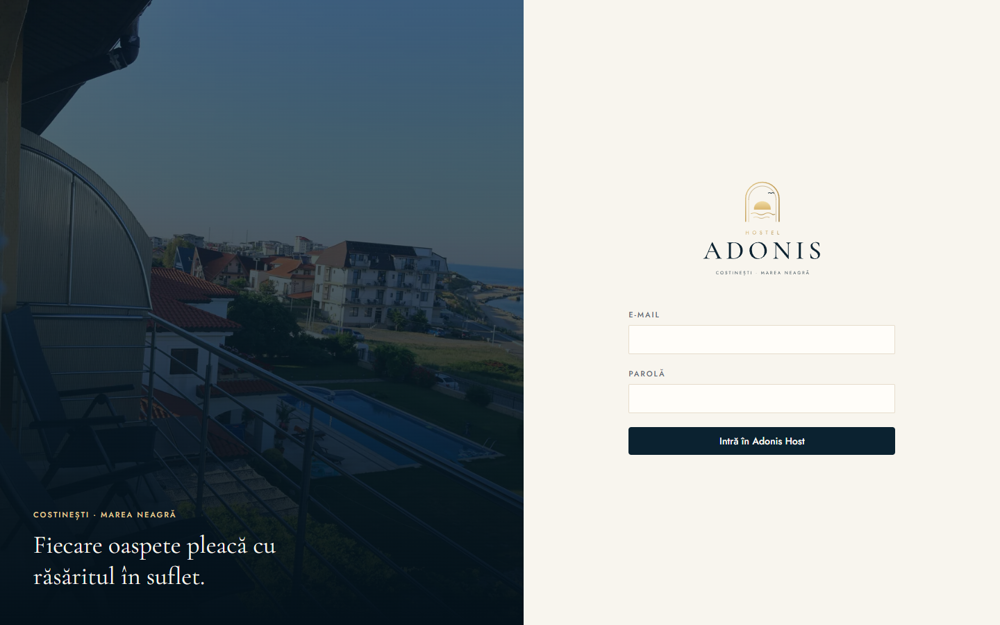

Fiecare coleg are contul lui (e-mail și parolă). La prima intrare, schimbați parola din colțul stânga-jos → „contul meu”. Recepția vede rezervările; colegii de la curățenie văd doar curățenia, camerele și consumabilele.

## Dimineața, la recepție: Panoul

- **Sosiri azi** și **Plecări azi**, cu butoanele *Check-in* și *Check-out* direct pe rând. La check-out camera trece automat la „De curățat” și colegii primesc notificare pe telefon.
- Chenarele colorate de sub cifre sunt lucrurile care cer atenție: rest de plată, rezervări neconfirmate, camere în reparație, recenzii proaste, stoc mic.
- **Starea camerelor**: fiecare cameră cu o linie colorată — verde pregătită, teracotă de curățat, chihlimbar de verificat, bordeaux în reparație.

## Rezervări

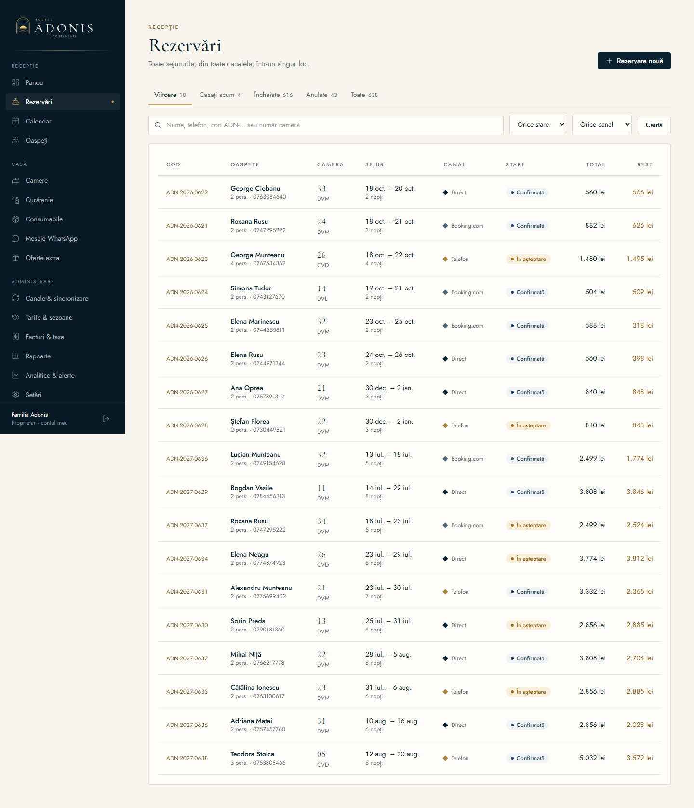

Căutați după nume, telefon, cod (`ADN-2026-…`) sau număr de cameră. Filele de sus: viitoare, cazați acum, încheiate, anulate.

### Rezervare nouă

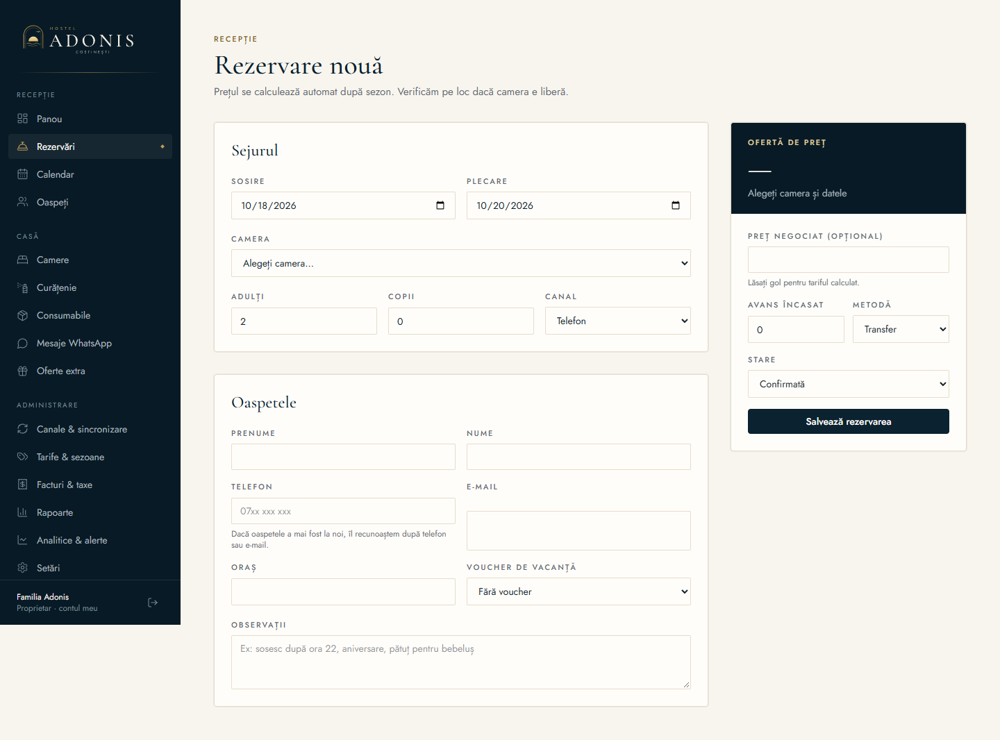

1. Alegeți datele și camera. **Prețul apare singur în dreapta**, după sezon, cu taxa turistică.
2. Dacă se cere minim de nopți (ex: 3 nopți în vârf de sezon) sau camera e ocupată, apare un avertisment.
3. Completați oaspetele. Dacă a mai fost la noi, îl recunoaștem după telefon sau e-mail.
4. Avansul încasat se trece imediat. Pentru vouchere de vacanță alegeți tipul (Sodexo, Edenred, UP, card de vacanță).

### Fișa rezervării

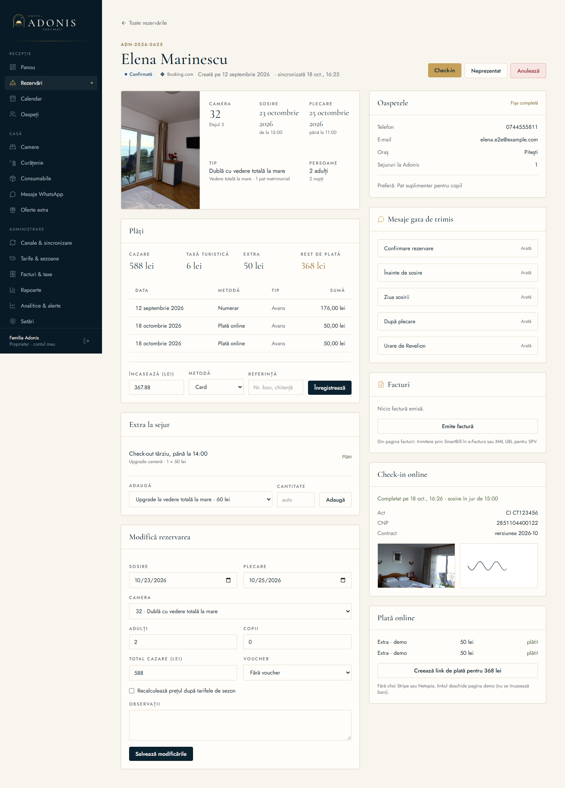

- **Plăți**: ce s-a încasat și restul. „Înregistrează” pentru numerar sau card la recepție; „Creează link de plată” pentru plata online.
- **Extra la sejur**: upgrade, check-out târziu, grătar, barca la răsărit.
- **Mesaje gata de trimis**: confirmarea, mesajul dinaintea sosirii (cu linkul de check-in online), Wi-Fi-ul în ziua sosirii. „Trimite pe WhatsApp”.
- **Check-in online**: dacă oaspetele l-a completat, vedeți actul, CNP-ul și semnătura contractului. La sosire, doar îi dați cheia.
- **Emite factură** la plecare.

## Calendar

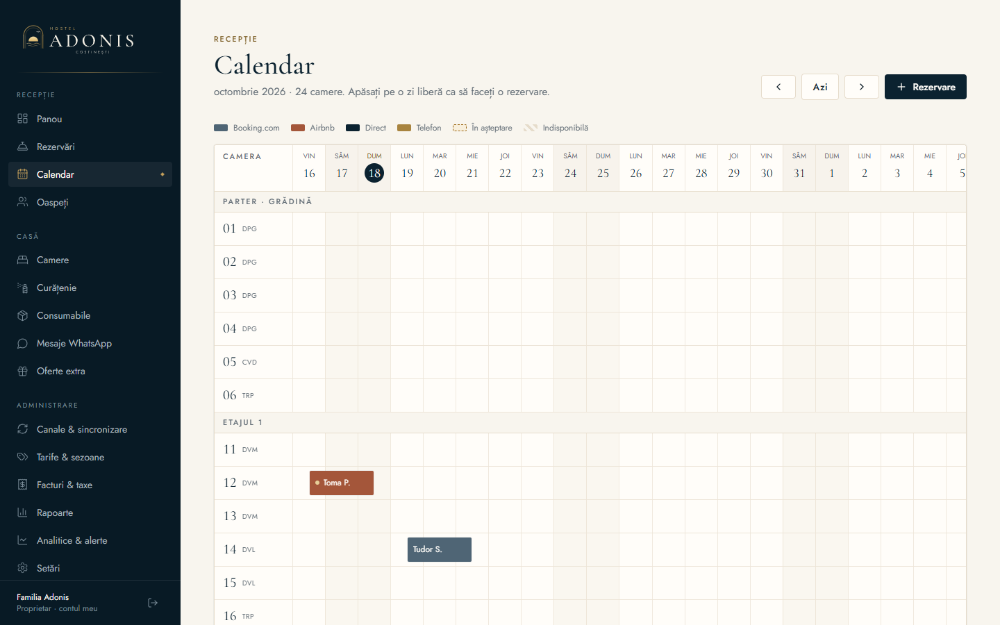

Toate camerele pe trei săptămâni. Culoarea arată canalul (bleumarin direct, gri-albastru Booking, teracotă Airbnb, auriu telefon); chenarul punctat înseamnă rezervare neconfirmată. **Apăsați pe o zi liberă** ca să faceți rezervare pe camera și data respectivă.

## Camere și curățenie

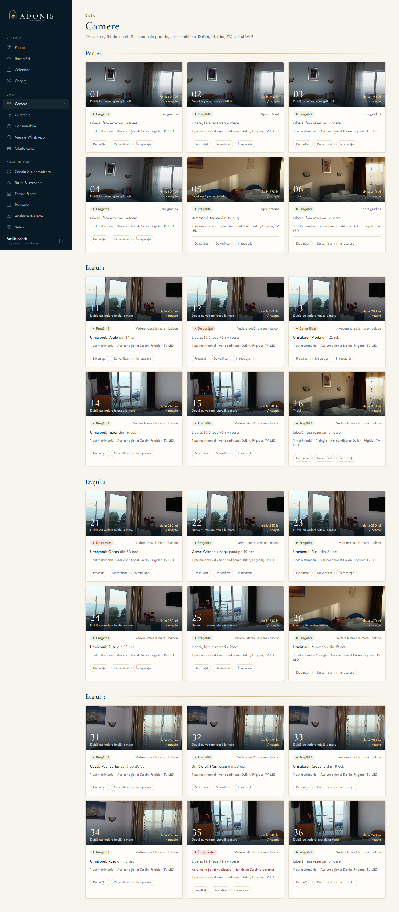
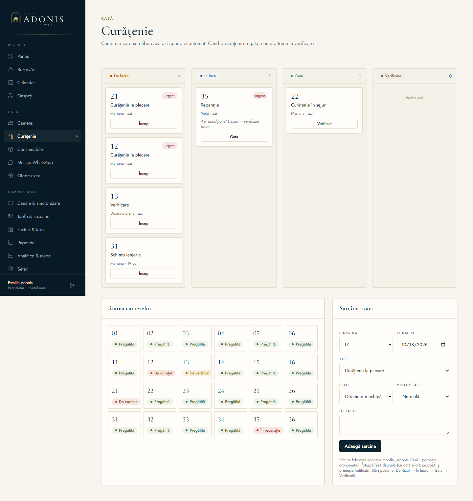

Sarcinile trec prin patru coloane: *De făcut → În lucru → Gata → Verificată*. Când o curățenie e gata, camera trece la „De verificat”; după verificare devine „Pregătită”.

### Aplicația „Adonis Casă” (telefon)

Colegii de la curățenie și întreținere folosesc aplicația de pe telefon:
- **Sarcini**: „Încep” pornește cronometrul, „Gata” îl oprește.
- **Daună**: butonul cu cameră face o poză; pe poză se scriu automat camera, data și ora.
- **Camere**: cine pleacă azi, cine sosește.
- **Consumabile**: +10 la aprovizionare, − la consum.
- Notificare pe telefon când o cameră se eliberează.

## Consumabile

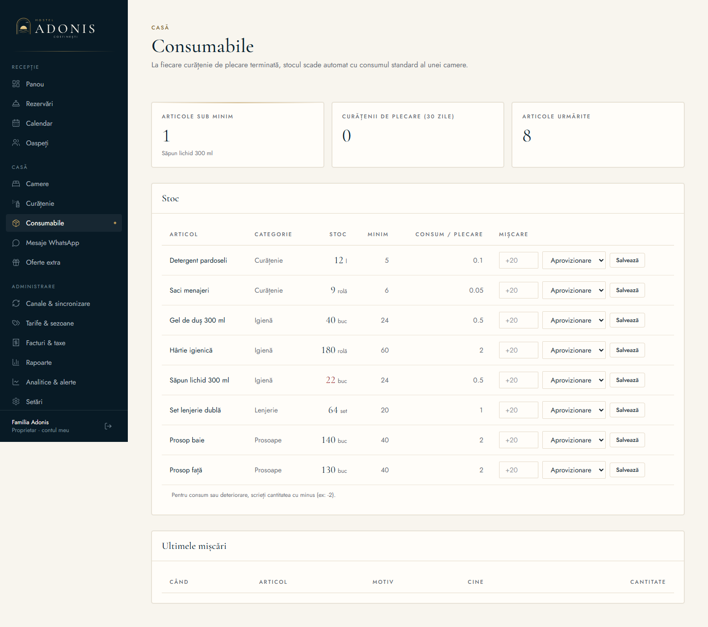

La fiecare curățenie de plecare terminată, stocul scade cu consumul standard al unei camere (lenjerie, prosoape, hârtie, săpun). Ce ajunge sub minim apare cu roșu și ca alertă în Panou.

## Mesaje WhatsApp

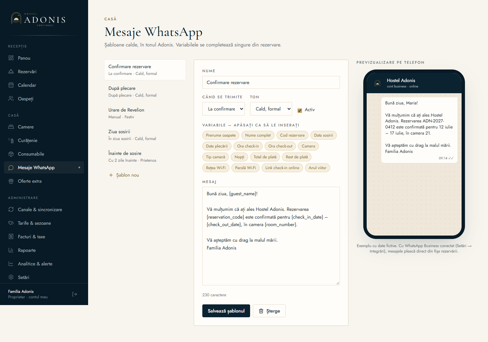

Editați șabloanele în tonul Adonis. Apăsați pe o variabilă (Prenume oaspete, Data sosirii, Parolă Wi-Fi…) ca să o inserați; în dreapta vedeți cum arată pe telefon. Variabilele scrise greșit sunt semnalate.

## Oferte extra

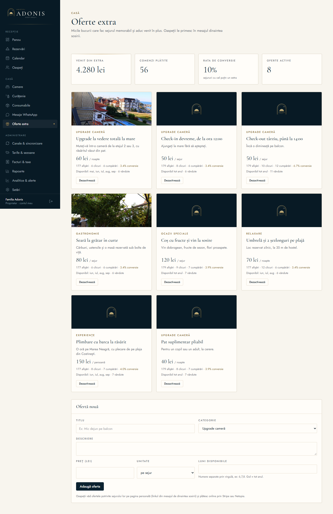

Oaspeții văd doar ofertele potrivite sejurului lor (luna, camera, câte zile mai sunt până la sosire) și le plătesc online. Pe fiecare ofertă vedeți afișări, clicuri, cumpărări și rata de conversie.

## Ce vede oaspetele pe telefon

| Check-in online | Bun venit | Oferte |
|---|---|---|
| 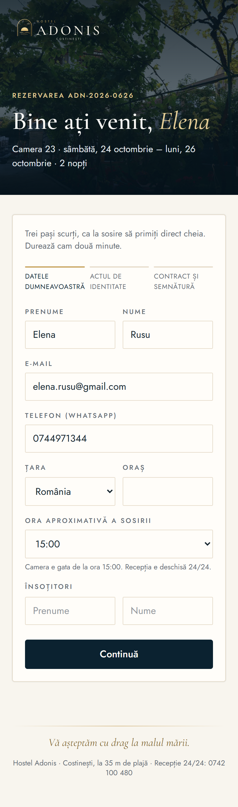 | 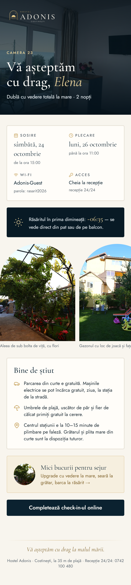 | 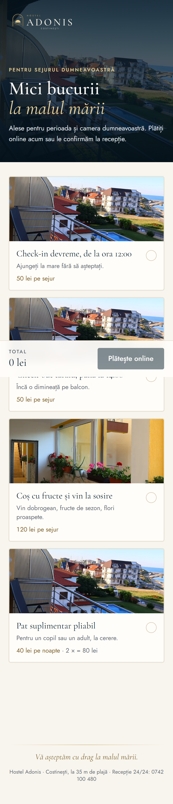 |

## Pentru proprietar și manager

- **Canale & sincronizare** 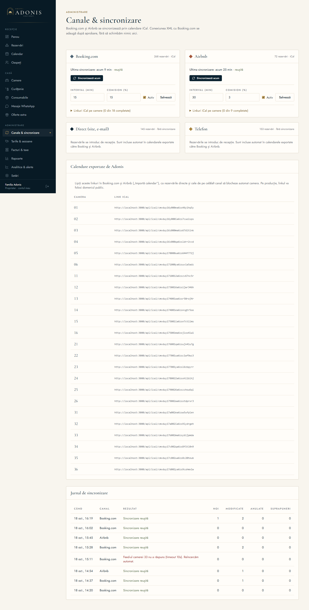 — linkurile iCal pe camere pentru Booking și Airbnb, sincronizarea manuală, jurnalul. Calendarele exportate de Adonis se lipesc în Booking și Airbnb ca să blocheze camerele vândute direct.
- **Tarife & sezoane** 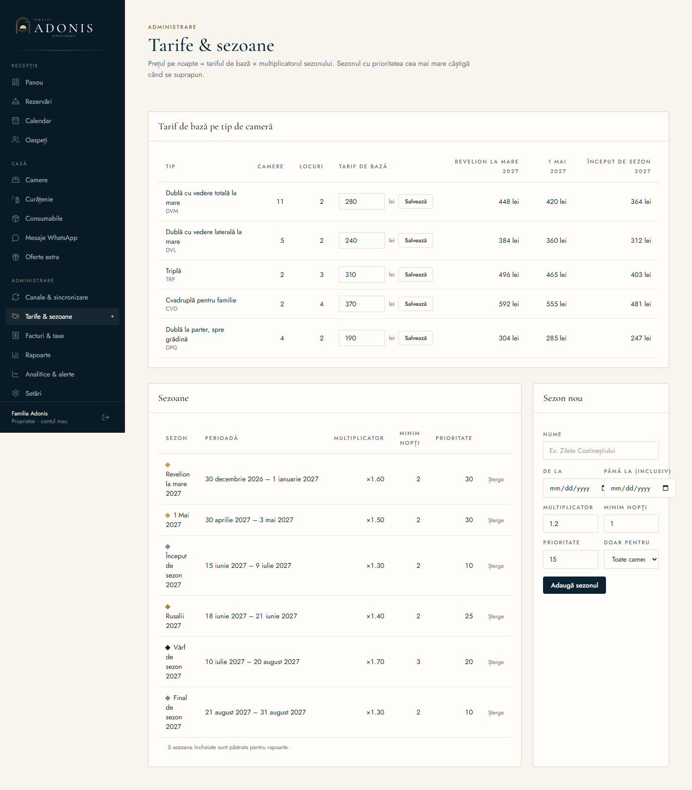 — tariful de bază pe tip de cameră și sezoanele cu multiplicator și minim de nopți.
- **Facturi & taxe** 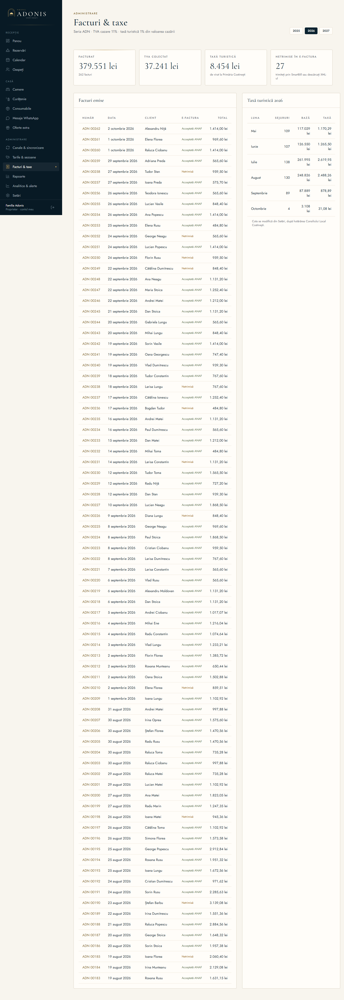 — facturile, XML-ul pentru e-Factura, trimiterea prin SmartBill, taxa turistică pe luni.
- **Rapoarte** 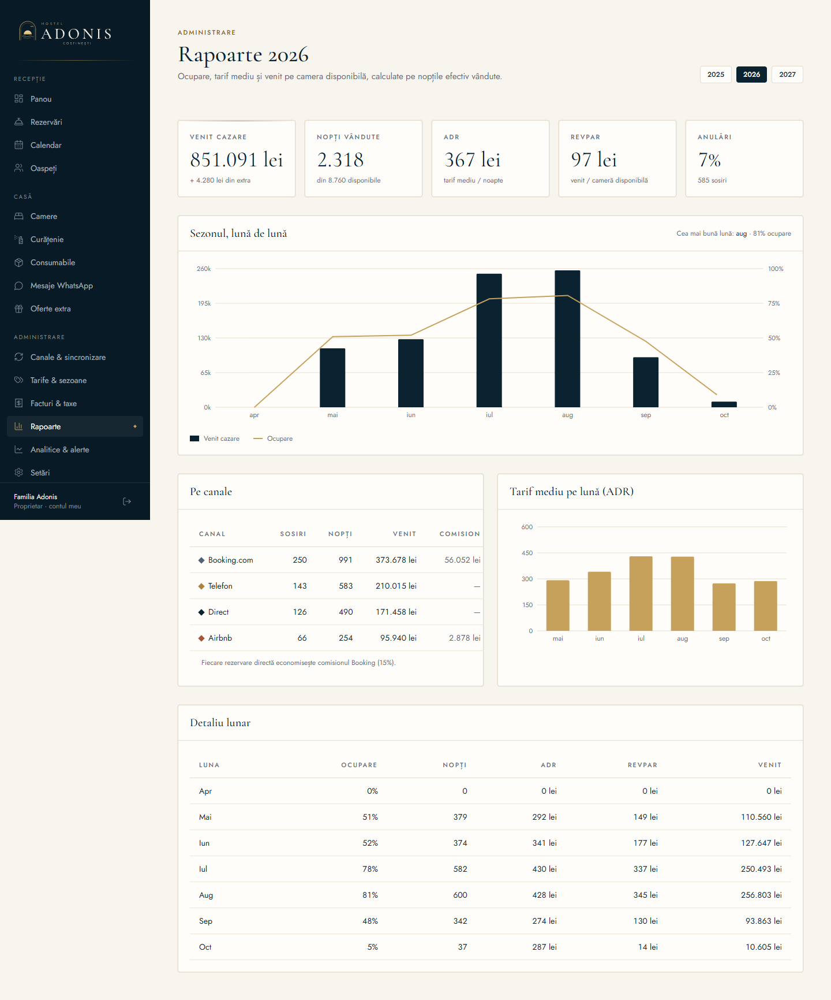 — ocupare, tarif mediu (ADR), venit pe cameră disponibilă (RevPAR), canale și comisioane.
- **Analitice & alerte** 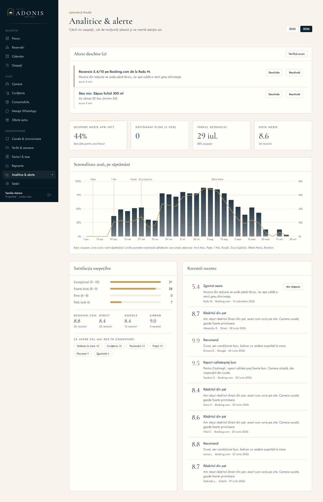 — sezonalitatea pe săptămâni cu sărbătorile, satisfacția oaspeților, alertele.
- **Setări** 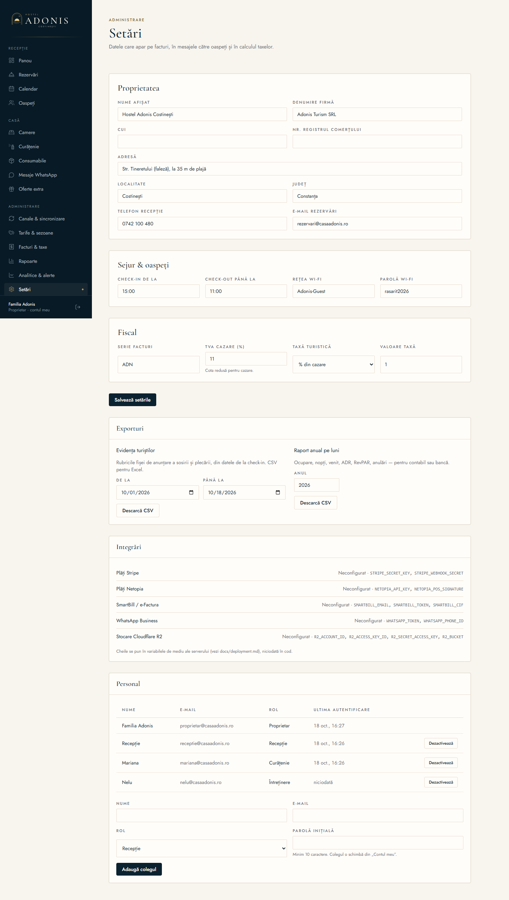 — datele firmei, Wi-Fi, TVA, taxa turistică, exportul evidenței turiștilor și al raportului anual, integrările, conturile colegilor.
